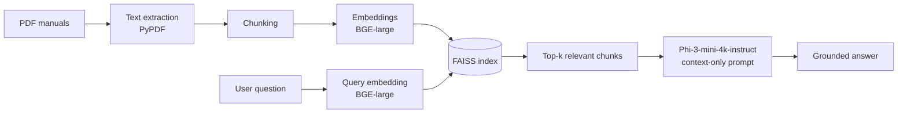

# Fully Local Lightweight RAG System for PDF-Based Manuals

A Retrieval-Augmented Generation (RAG) system that answers questions about PDF manuals entirely on your own machine. No API keys, no cloud calls, and no data leaving your computer.

Answers are grounded strictly in the retrieved manual content. If the answer is not in the documents, the system says so instead of guessing.

---

## Overview

Large language models often "hallucinate" when asked about specific documents they have never seen. This project addresses that for closed-corpus PDF manuals by combining:

- **Dense retrieval** with BGE-large embeddings and a FAISS vector index
- **Local generation** with Phi-3-mini-4k-instruct
- **Context-only grounding**, where the model is instructed to answer only from retrieved passages

## Features

- **Fully local:** all extraction, embedding, retrieval, and generation run offline after the models are downloaded
- **Document-grounded answers:** responses come only from the indexed manuals
- **Hallucination control:** the system declines to answer when the context does not contain the answer
- **Lightweight:** a small language model (Phi-3-mini) keeps hardware requirements modest
- **Reusable index:** PDFs are embedded once and the FAISS index is saved for later queries

## How It Works



**1. Ingestion**
1. Extract text from each PDF with PyPDF.
2. Split the text into overlapping chunks.
3. Encode each chunk with BGE-large into a dense vector.
4. Store the vectors in a FAISS index.

**2. Question answering**
1. Encode the user's question with the same embedding model.
2. Retrieve the top-k most similar chunks from FAISS.
3. Pass the chunks and the question to Phi-3-mini with a prompt that restricts it to the given context.
4. Return the answer, or a "not found in the manual" response if the context is insufficient.

## Tech Stack

| Component | Tool |
|---|---|
| Language | Python |
| PDF text extraction | PyPDF |
| Embedding model | BGE-large (`<exact model ID, e.g., BAAI/bge-large-en-v1.5>`) |
| Vector index | FAISS |
| Language model | Phi-3-mini-4k-instruct (`microsoft/Phi-3-mini-4k-instruct`) |

## Project Structure

<!-- Update this tree to match your repository. -->

```
local-pdf-rag/
├── data/                  # Source PDF manuals
├── index/                 # Saved FAISS index and chunk metadata
├── ingest.py              # Extract, chunk, embed, and index PDFs
├── query.py               # Ask questions against the index
├── requirements.txt       # Python dependencies
└── README.md
```

## Getting Started

### Prerequisites

- Python `<version, e.g., 3.10+>`
- `<RAM / GPU requirements, e.g., 16 GB RAM; GPU optional>`
- Internet access only for the first model download

### Installation

```bash
git clone https://github.com/<your-username>/<repo-name>.git
cd <repo-name>
pip install -r requirements.txt
```

### Usage

<!-- Replace these commands with the ones your scripts actually use. -->

**Index your PDF manuals:**

```bash
<your ingestion command, e.g., python ingest.py>
```

**Ask a question:**

```bash
<your query command, e.g., python query.py>
```

## Configuration

| Setting | Description | Value |
|---|---|---|
| Chunk size | Characters or tokens per chunk | `<value>` |
| Chunk overlap | Overlap between consecutive chunks | `<value>` |
| Top-k | Number of chunks retrieved per question | `<value>` |
| Max new tokens | Maximum answer length | `<value>` |

## Limitations

- Scanned PDFs without a text layer need OCR before ingestion.
- Tables, diagrams, and images in manuals are not interpreted.
- Answer quality depends on chunking and retrieval; questions that need information spread across many sections may be answered partially.
- Phi-3-mini has a 4K-token context window, which limits how much retrieved text can be passed at once.

## Author

- **Leila Janine T. Villegas** · [ljaninevillegas@gmail.com](mailto:ljaninevillegas@gmail.com)

## License

`<License, e.g., MIT>`
